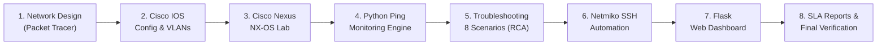

# NexGuard – Enterprise Network Monitoring & Troubleshooting System

[](https://www.python.org/)
[](https://flask.palletsprojects.com/)
[](https://www.cisco.com/)
[](https://www.cisco.com/)
[](https://github.com/ktbyers/netmiko)
[](https://www.sqlite.org/)

---

## 📌 Executive Summary

**NexGuard** is a production-grade enterprise network monitoring, diagnostic, and automation platform engineered to bridge hands-on network engineering with software automation. Designed specifically for enterprise technical support and network operations roles (such as Kyndryl Technical Support), NexGuard demonstrates end-to-end competencies across **Cisco IOS**, **Cisco Nexus (NX-OS)** data center switching, network packet troubleshooting, and **Python-based automation**.

NexGuard simulates a multi-department enterprise environment, provides active polling and SSH-based telemetry collection, logs historical availability, tracks incidents, and delivers actionable diagnostics through an interactive web dashboard.

---

## 🏢 Enterprise Topology & VLAN Architecture

The simulated enterprise infrastructure connects four core departments and a centralized server farm through an enterprise campus design:

```
                                [ Core / WAN Router ]
                                         |
                                [ Inter-VLAN Router ]
                               (Sub-interfaces / 802.1Q)
                                         |
                               [ Distribution Switch ]
                             (Trunk Links: 802.1Q / VTP)
                                 /       |       \
               +----------------+        |        +----------------+
               |                         |                         |
       [ Access Switch 1 ]       [ Access Switch 2 ]       [ Nexus Data Center Switch ]
        (HR & Finance)            (IT & Support)               (Server Farm)
        /             \           /             \                    |
   VLAN 10         VLAN 20     VLAN 30       VLAN 40              VLAN 50
   (192.168.10.0)  (192.168.20.0) (192.168.30.0) (192.168.40.0)  (192.168.50.0)
     HR Dept        Finance Dept   IT Support    Cust Support       Data Center
```

### VLAN Segmentation Matrix

| VLAN ID | Name | Subnet / CIDR | Default Gateway | Purpose |
|:---:|:---|:---|:---|:---|
| **10** | HR | `192.168.10.0/24` | `192.168.10.1` | HR Workstations & Local Printers |
| **20** | Finance | `192.168.20.0/24` | `192.168.20.1` | Finance Workstations & Accounting Terminals |
| **30** | IT | `192.168.30.0/24` | `192.168.30.1` | IT Staff, SysAdmin Stations & Jump Hosts |
| **40** | Support | `192.168.40.0/24` | `192.168.40.1` | Customer Support Helpdesk Terminals |
| **50** | Servers | `192.168.50.0/24` | `192.168.50.1` | Central DNS, DHCP, Web, Syslog & DB Servers |

---

## 🛠️ Technology Stack

| Layer / Domain | Technology | Purpose |
|---|---|---|
| **Network Simulation** | Cisco Packet Tracer / GNS3 / EVE-NG | Multi-VLAN enterprise campus simulation |
| **Campus Routing & Switching** | Cisco IOS (Routers & Catalyst Switches) | 802.1Q trunking, Router-on-a-Stick, SVIs, Access Control |
| **Data Center Switching** | Cisco Nexus / NX-OS (Cisco DevNet Sandbox / vNX-OS) | Virtual PortChannels (vPC), Nexus CLI, data center fabric |
| **Network Automation** | Python 3, Netmiko | Headless SSH command dispatch, configuration inspection |
| **Monitoring Engine** | Python Subprocess / Scapy / Socket | ICMP ping latency, packet loss, socket reachability |
| **Backend & REST APIs** | Flask, SQLAlchemy | Modular API endpoints, scheduled background polling |
| **Storage & Persistence** | SQLite | Historical latency logs, device inventory, incident tickets |
| **Frontend Dashboard** | HTML5, Modern CSS, Vanilla JS, Chart.js | Real-time status badges, latency charts, incident console |
| **Protocol Analysis** | Wireshark | Deep packet inspection, 3-way handshake & ARP analysis |

---

## 🏗️ 4-Tier System Architecture

1. **Enterprise Network Layer**:
   - Routers, Catalyst switches, Nexus switches, and multi-VLAN workstations.
   - Inter-VLAN routing configured via 802.1Q trunking and DHCP relay agents.
2. **Monitoring & Automation Engine (Python)**:
   - ICMP ping service checking latency, jitter, and packet loss.
   - Netmiko SSH engine running `show ip interface brief`, `show vlan brief`, and `show ip route`.
   - Automated threshold evaluation generating alerts when latency spikes or packets drop.
3. **Backend & Persistence Layer (Flask + SQLite)**:
   - RESTful API endpoints serving `/api/devices`, `/api/monitoring`, `/api/incidents`, `/api/reports`.
   - SQLite relational schema tracking devices, logs, incidents, and troubleshooting notes.
4. **Frontend Operations Center**:
   - Responsive web dashboard providing single-pane-of-glass visibility.
   - Interactive diagnostic console for running automated checks and reviewing incident history.

---

## 📂 Project Structure

```text
NexGuard/
├── backend/
│   ├── app.py                      # Flask entry point & application factory
│   ├── config.py                   # App configuration & environment variables
│   ├── routes/
│   │   ├── devices.py              # Device inventory management API
│   │   ├── monitoring.py           # Real-time polling & telemetry API
│   │   ├── incidents.py            # Incident creation, lifecycle & escalation
│   │   └── reports.py              # Uptime reports & SLA statistics
│   ├── services/
│   │   ├── device_monitor.py       # Orchestrator for periodic background checks
│   │   ├── ping_service.py         # Subprocess-based cross-platform ICMP ping
│   │   ├── network_scanner.py      # IP subnet discovery & sweep scanner
│   │   ├── ssh_service.py          # Netmiko SSH automation for Cisco IOS/NX-OS
│   │   └── alert_service.py        # Incident generator & alert dispatcher
│   ├── models/
│   │   ├── device.py               # Device model (IP, name, type, vendor, rack)
│   │   ├── incident.py             # Incident tracking model (severity, status)
│   │   └── monitoring_log.py       # Historical latency & uptime logs
│   └── requirements.txt            # Python dependencies
│
├── frontend/
│   ├── templates/
│   │   ├── base.html               # Shared layout, navbar & sidebar navigation
│   │   ├── dashboard.html          # High-level metrics, health cards, quick alerts
│   │   ├── devices.html            # Inventory table with live status badges
│   │   ├── monitoring.html         # Real-time ping graphs & performance charts
│   │   ├── incidents.html          # Active tickets & troubleshooting console
│   │   └── reports.html            # Uptime summaries & device failure history
│   └── static/
│       ├── css/                    # Custom enterprise dark/light stylesheets
│       ├── js/                     # Chart.js initialization & live polling JS
│       └── images/                 # Architecture diagrams, logos & icons
│
├── network-labs/
│   ├── cisco-ios/                  # IOS configurations (.cfg) & switch scripts
│   ├── cisco-nexus/                # NX-OS configurations, vPC & interface setups
│   └── topologies/                 # Cisco Packet Tracer (.pkt) & topology diagrams
│
├── troubleshooting/
│   ├── vlan-issues.md              # Scenario 1 & 2: Misconfigured VLANs & tags
│   ├── routing-issues.md           # Scenario 3 & 4: Sub-interface & route errors
│   ├── connectivity-issues.md      # Scenario 5, 6, 7 & 8: Duplex, MTU, packet drop
│   └── troubleshooting-log.md      # Consolidated technical log with RCA format
│
├── database/
│   └── nexguard.db                 # SQLite relational database instance
│
├── screenshots/                    # Dashboard captures & Packet Tracer proof
├── tests/                          # Unit and integration test suites
├── .env.example                    # Sample environment secrets & SSH credentials
├── .gitignore                      # Git exclusion rules
└── README.md                       # Master project documentation
```

---

## 🎯 Core Modules & 30-Day Implementation Roadmap



| Phase | Days | Module | Core Deliverable |
|:---:|:---:|:---|:---|
| **Week 1** | Days 1–4 | **Module 1: Enterprise Network Design** | 5 VLANs, Packet Tracer `.pkt` file, IP Addressing Scheme |
| | Days 5–8 | **Module 2: Cisco IOS Configuration** | Router-on-a-stick, 802.1Q trunks, access ports, VTP/SVI |
| **Week 2** | Days 9–11 | **Module 3: Cisco Nexus (NX-OS)** | NX-OS CLI practice, Port-Channels, SVI configuration, DevNet |
| | Days 12–15 | **Module 4: Python Monitoring Engine** | Cross-platform ICMP latency parser, status evaluation engine |
| **Week 3** | Days 16–19 | **Module 5: Troubleshooting Engine** | 8 intentional enterprise failure scenarios with complete RCA |
| | Days 20–22 | **Module 6: Network Automation** | Netmiko scripts gathering `show` outputs over encrypted SSH |
| **Week 4** | Days 23–27 | **Module 7: Flask Monitoring Dashboard** | Web UI with real-time health badges, incident management |
| | Days 28–30 | **Module 8: Reports & Documentation** | SLA uptime reports, GitHub documentation, interview readiness |

---

## 🔍 Enterprise Troubleshooting Scenarios (Kyndryl Prep)

Each scenario follows the structured enterprise troubleshooting methodology:
**Symptom ➔ Diagnosis (Commands) ➔ Root Cause Analysis (RCA) ➔ Resolution ➔ Verification**.

| # | Scenario | Symptom | Diagnostic Commands | Root Cause | Corrective Action |
|:---:|:---|:---|:---|:---|:---|
| **1** | **Incorrect IP / Subnet** | Host cannot reach default gateway | `ipconfig`, `show ip arp`, `show mac address-table` | Workstation assigned wrong subnet mask or gateway | Fix host IP or DHCP pool configuration |
| **2** | **VLAN Assignment Mismatch** | HR host isolated on local switch | `show vlan brief`, `show interfaces status` | Switchport placed in wrong access VLAN | `switchport access vlan 10` on target port |
| **3** | **Trunk Encapsulation / Native VLAN Mismatch** | Intermittent traffic drop across switches | `show interfaces trunk`, `show spanning-tree` | Native VLAN mismatch or trunk allowed list missing target VLAN | Correct `switchport trunk native vlan` & allowed lists |
| **4** | **DHCP Scope Exhaustion / Relay Failure** | New host falls back to APIPA (`169.254.x.x`) | `show ip dhcp binding`, `show ip dhcp conflict` | Missing `ip helper-address` on default gateway sub-interface | Configure `ip helper-address 192.168.50.10` on SVI |
| **5** | **Inter-VLAN Routing Failure** | VLAN 10 cannot ping VLAN 20 | `show ip route`, `show ip interface brief` | Sub-interface missing 802.1Q tag or admin down | Add `encapsulation dot1Q <vlan>` and `no shutdown` |
| **6** | **DNS Resolution Failure** | Hosts reach IP addresses but cannot browse services | `nslookup`, `ping <hostname>`, `show ip hosts` | Primary DNS server down or wrong DNS IP pushed by DHCP | Update DHCP DNS option & verify port 53 reachability |
| **7** | **Interface Speed / Duplex Mismatch** | Severe packet loss, high collisions | `show interfaces <port>`, `show controllers` | One side hardcoded full-duplex while other is auto-negotiating | Standardize duplex/speed to `speed auto` / `duplex auto` |
| **8** | **High Latency / Link Degradation** | Latency jumps from 2ms to 280ms | Python ping engine, Wireshark packet capture | Broadcast storm, STP loop, or oversubscribed uplink | Enable Spanning Tree BPDU Guard & inspect link utilization |

---

## 🚀 Quick Start Guide

### 1. Clone & Setup Python Virtual Environment

```powershell
# Clone the repository
git clone https://github.com/your-username/NexGuard.git
cd NexGuard

# Create and activate virtual environment (Windows)
python -m venv venv
.\venv\Scripts\Activate.ps1

# (Linux / macOS)
# python3 -m venv venv
# source venv/bin/activate
```

### 2. Configure Environment Variables

```powershell
cp .env.example .env
```

### 3. Install Dependencies & Run

```powershell
pip install -r backend/requirements.txt
python backend/app.py
```

Access the dashboard at: `http://127.0.0.1:5000`

---

## 🎓 Technical Interview Talking Points (Kyndryl / Enterprise Support)

1. **VLAN Segmentation & Security**:
   - Why separate HR, Finance, and IT? Restricts broadcast domains, enhances security policies, and simplifies compliance auditing.
2. **Cisco IOS vs. Cisco Nexus (NX-OS)**:
   - IOS: Monolithic kernel, sequential configuration parsing.
   - NX-OS: Modular Linux-based microkernel, feature-based licensing/enabling (`feature vpc`, `feature lacp`), Virtual Port Channels (vPC) eliminating STP blocking in data centers.
3. **Automated Network Telemetry**:
   - Using Python subprocess with non-blocking execution prevents GUI freezes while continuously tracking jitter and latency across hundreds of endpoints.
4. **Programmatic Device Management**:
   - Netmiko securely encapsulates SSH sessions, handles prompt timeouts, and enables automated configuration backups without manual CLI logging.

---

## 📜 License & Credits

Developed as part of the **NexGuard Enterprise Networking & Automation Portfolio** for Enterprise Infrastructure and Technical Support engineering roles.
